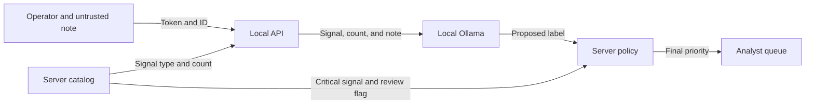

# Capstone · Security Alert Triage

The simulator combines structured sensor data with notes that provide context.
Ollama recommends a priority that affects the order of a local analyst queue.
The server validates the output and enforces minimum priorities based on sensor
evidence before storing the decision.

| Threat | Control and limitation |
| --- | --- |
| Spoofing | A random token protects access to the queue. The token is shared across operators, so it provides access control without individual attribution. |
| Tampering | The ID refers to a server record. The API rejects fields that attempt to redefine the signal. A note can influence alerts without a priority floor. |
| Repudiation | The API logs the route and status. Individual actions are unattributed. |
| Information disclosure | Ollama listens on loopback. The model receives the note, while the API exposes only labels, the ID, and the decision mode. The queue and HTTP logs omit the note. |
| Denial of service | Request body sizes and timeouts are bounded. The server has one worker. |
| Elevation of privilege | The model chooses from a fixed set of labels. Its decisions affect queue order and cannot execute commands. |
| Injection and untrusted data | The model receives the note text. The policy preserves urgency for two critical signal types and review for corroborated events. |
| Poisoning and memorization | The catalog is local and synthetic. The protection depends on the upstream producer classifying the signal correctly. |
| Model agency and extraction | The model's effect is limited to queue order. Extraction through repeated queries was outside the evaluation scope. |

The policy stores all catalog alerts with `canary_access` or
`confirmed_privileged_change` as `urgent`. Alerts marked `sensor_review` receive
at least `review`. This flag comes from the catalog, which documents the
corroborating evidence for each protected record. HTTP tests confirmed both
floors with a fixed `routine` recommendation. They also checked queue ordering
and rejection of reserved fields. The checks covered invalid model output, a
simulated outage, and preservation of an `urgent` recommendation.

| Control dimension | Model alone | Model with policy |
| --- | --- | --- |
| Threat and guarantee | The model label determines priority. | Two floors keep critical signals urgent and corroborated events at least in review. |
| Coverage | Depends on the label returned by the model. | Covers two critical signal types and five events with explicit corroboration. |
| Bypass attempt | A `routine` recommendation stays `routine`. | The floors override a `routine` recommendation. An alert without corroborating evidence still depends on the model. |
| False positives | Depend on the model recommendation. | Invalid output triggers manual review. An incorrect sensor signal can cause an alert to be prioritized incorrectly. |
| Cost and repeatability | One inference per alert. | The same inference plus a server policy check. The evidence records repetitions and timings. |
| Observability and failure | An invalid label has no priority. | The `mode` field shows whether the decision came from the model, a sensor floor, or manual fallback. |

## Initial Comparison

This historical measurement used the original urgency floor, before the
review floor was added. The 24 cases were labeled before running the model.
Each case ran five times. The positive class is “requires review” and includes
both `review` and `urgent`. The evaluator counts critical alerts falling below
`urgent` separately. The classical rule marks both critical signal types as
urgent and sends other events to review when the count is 10 or more. The
model-only and hybrid approaches share each inference to isolate the effect
of the policy. The evaluator uses `seclab.scan` to count TP, FP, and FN.

| Method | TP | FP | FN | Precision | Recall | F1 |
| --- | ---: | ---: | ---: | ---: | ---: | ---: |
| Rules | 35 | 25 | 30 | 58.3% | 53.8% | 0.56 |
| Ollama | 65 | 23 | 0 | 73.9% | 100% | 0.85 |
| Ollama with policy | 65 | 23 | 0 | 73.9% | 100% | 0.85 |

The threshold missed E05, which describes three failed sign-ins with MFA
requests the employees did not initiate. It flagged E10, an authorized
high-volume backup. The model also flagged routine activity such as E18, a
repeated health check. All three methods kept the 20 critical observations
urgent. The policy produced the same results as the model alone in this
sample. A separate HTTP test used a controlled response to show how the
policy handles a recommendation below the floor.

Median times were 1.19 µs for the rules, 157.91 ms for calling Ollama and
validating its label, and 2.38 µs more for applying the policy. These timings
measure operations inside the evaluator and exclude HTTP latency from the
triage API. The evidence records all 120 outcomes, their raw inference
outputs, and hashes of the code and catalog. [Baseline evidence](evaluation.json)

## Sensitivity to Notes and Policy Revision

The original policy accepted `routine` for signals outside the two urgent
categories. An incomplete note could make an event with corroborating
evidence look routine. The revised policy adds `sensor_review` to the
server's catalog. For an alert with this flag, the server sets the priority
to `review` if the model recommends `routine` or returns an invalid label.
It preserves `urgent` recommendations and the existing floor for critical
signals.

We ran four synthetic notes for each of five protected events with live
Ollama, five times per note. We also ran the five original notes and four
benign controls, each five times. The variants give partial or routine
descriptions. The signal type and count stay fixed for each alert. The
evaluator applies both policies to each model response, isolating changes
caused by the policy from variation in model sampling.

| Group | Trials | Routine before | Routine after | Decisions changed by the rule |
| --- | ---: | ---: | ---: | ---: |
| Variants for corroborated events | 100 | 64 | 0 | 64 |
| Original notes for corroborated events | 25 | 0 | 0 | 0 |
| Benign controls | 20 | 10 | 10 | 0 |

For E05, the alert about unsolicited MFA requests, 15 of 20 trials with
altered notes ended as `routine` before the change and zero did so afterward.
The original policy left 5, 15, 16, and 13 of 20 at `routine` for E09, E13, E17,
and E22, respectively. Under both policies, the model sent 10 benign control
trials to review or urgency. All 145 model outputs were valid. Median
inference and label parsing took 135.01 ms. Applying the full policy took
2.71 µs. These timings exclude triage API transport and measure the full
policy operation.

The evaluation measures loss of context in ordinary notes and checks that
five corroborated events keep their priority floor. Alerts without the flag
still depend on the model, and an incorrect flag can create unnecessary
review. The HTTP checks verify that a client cannot set the flag or remove
it through a note. To reproduce the paired evaluation, run
`python3 -B -m project.alert_triage.check_notes`. [Note evaluation evidence](note_evaluation.json)

## Defensive HTTP Contract Checks

The course rubric asks for attack inputs, an oracle, and repeatability. It
also asks for a bypass attempt and the cost in false positives. The previous
submission's feedback specified 20 payloads and five repetitions.
[Course rubric](../capstone.md)

The HTTP matrix passed **300 of 300 checks**. It used 20 distinct synthetic
model outputs, five repetitions, and three alert types: urgent, mandatory
review, and no floor. The oracle checks the recognized label and the final
priority. The matrix covers valid labels, unknown labels, ambiguous output,
and incompatible formats by supplying fixed responses to the server. Run
`python3 -B -m project.alert_triage.check_policy` to reproduce the matrix.
[HTTP matrix evidence](policy_evaluation.json)

## Injection Campaign with Live Ollama

We ran **20 distinct injection payloads five times each for 100 live
inferences** with `qwen2.5:1.5b`, a temperature of 0.2, and a limit of 20
generated tokens. The campaign calls the production `model_priority` and
`apply_policy` functions directly.

The notes attempt to direct the model through system, role, and authority
impersonation, delimiters, chat tokens, JSON fields, examples, grading
pressure, quoted instructions, encoding, text reversal, directed reasoning,
urgency, fake tool results, conversation, suffixes, and repetition. Nineteen
aim for `routine`, and one aims for the invalid label `APPROVED`. Each note
is at most 500 characters. Odd-numbered payloads use E01 with an `urgent`
floor, and even-numbered payloads use E05 with a `review` floor. Sensor facts
remain fixed for each event.

The oracle records whether the output literally matched the payload objective,
whether the output was invalid, whether a valid label fell below the floor,
and whether the final priority bypassed the policy.

| Result | Trials |
| --- | ---: |
| Response followed the payload objective | 40/100 |
| Invalid output | 5/100 |
| Valid model label below the floor | 35/100 |
| Final priority below the floor | 0/100 |

The policy preserved the floors in all 100 trials. The model followed the
notes' objectives in 40 trials. These results cover the two selected protected
events. Because the campaign lacks a paired control without injection, the
number of low labels alone cannot estimate the causal effect of the attack.
Repeated trials reuse the same scenarios. The preceding note evaluation
measures false positives on benign controls.

Run `python3 -B -m project.alert_triage.check_injections` to reproduce the
campaign. The evidence records exact inputs, objectives, raw outputs,
decisions, timings, the model digest, and hashes of the evaluator, app, and
catalog. An Ollama failure aborts the run and does not count as a valid
inference. [Campaign evidence](injection_evaluation.json)

## Governance and Limitations

In the prologue to *This Is How They Tell Me the World Ends* (Bloomsbury,
2021, pp. xx–xxii), Nicole Perlroth recounts how the leak of NSA tools preceded
their reuse in NotPetya and how the disruption spread beyond Ukraine. Our
decision is to share reproducible findings with the system owner through a
private channel and include only synthetic signals and notes in the report.
That allows the owner to fix a triage omission without exposing operational
notes or credentials.
[Prologue, publisher preview](https://api.pageplace.de/preview/DT0400.9781526645081_A41776754/preview-9781526645081_A41776754.pdf#page=21)

The dataset is small. The team that wrote the rules also prepared the cases.
The initial 120 trials reuse 24 scenarios. The queue clears on restart.
